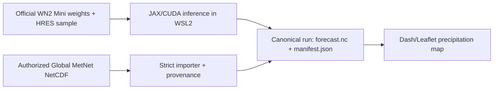

# WeatherNext Local

Run the official **WeatherNext 2 Mini** research checkpoint on a single NVIDIA
GPU and explore its precipitation forecast on an interactive world map. The
same dashboard can catalog authorized **Global MetNet** nowcast outputs without
misrepresenting imported data as locally generated inference.

This repository is deliberately exact about what is and is not executable:

| Capability | Local status | Resolution / cadence | Notes |
|---|---:|---:|---|
| WeatherNext 2 full model | Not supported on this GPU | 0.25° / 6 h | The official repository requires H100-class memory. |
| `WeatherNextCyclones_Mini_<2024` | Verified: 1 step / 1 member | 1.0° / 6 h | Official WN2/FGN-family checkpoint; the conservative path completed on this RTX 4070. |
| Global MetNet | Blocked on upstream artifacts | ~0.05° / 15 min, 12 h | Google has published the system and paper, but not executable source code or weights. |
| Authorized Global MetNet output | Import and visualize | Preserved from source | Recorded as an import, never as a local model run. |

The full model and Mini constraints come from the pinned
[Google DeepMind WeatherNext v0.3.0 repository](https://github.com/google-deepmind/weathernext/tree/v0.3.0).
Global MetNet capability comes from its
[official paper](https://arxiv.org/abs/2510.13050). This is research software,
not an official weather forecast, alert, or warning.

## Why WSL2

This computer has an RTX 4070 with 12,282 MiB VRAM, 96 GB system RAM, and a
current NVIDIA driver. JAX CUDA execution is not supported by native Windows;
the model therefore runs in an isolated Ubuntu WSL2 distribution. The setup
does not modify or remove other registered WSL distributions.

The tested architecture is:



## Quick start

Open PowerShell in this repository. The first command creates or reuses an
isolated WSL distribution named `WeatherNext`, installs Python 3.12 and a pinned
environment under `/opt/weathernext-local`, and verifies JAX:

```powershell
powershell -ExecutionPolicy Bypass -File .\scripts\setup.ps1
.\scripts\wnx.cmd doctor
```

On a computer where WSL2 is not already enabled, run the setup command from an
Administrator PowerShell. Windows may require a restart after enabling WSL;
restart and run the same setup command again. Existing WSL distributions are
not removed or modified unless they are the validated `WeatherNext` distro;
that named distro is deliberately reused and its `/opt/weathernext-local`
environment is updated.

Before creating a missing `WeatherNext` distro, setup verifies that the
installed WSL package reports its version and advertises the required
`wsl.exe --install` options (`--name`, `--location`, and `--vhd-size`). If that
preflight fails, open an Administrator PowerShell, run `wsl.exe --update`,
restart Windows if requested, and rerun setup. If WSL is not installed, first
run `wsl.exe --install --no-distribution`, restart, and then update WSL.

Provisioning runs as WSL root only long enough to install the verified toolchain
under `/opt`. Model, importer, test, and dashboard commands run as the dedicated
unprivileged `weathernext` user.

Download the official checkpoint plus the smallest official input sample. Both
files are checked against their published byte sizes and GCS MD5 values before
they are installed:

```powershell
.\scripts\wnx.cmd fetch --steps 1
```

Run the conservative RTX 4070 configuration:

```powershell
.\scripts\wnx.cmd run --steps 1 --members 1
```

Then launch the dashboard and open <http://127.0.0.1:8050>:

```powershell
.\scripts\wnx.cmd dashboard --port 8050
```

The dashboard binds to loopback by default and has no authentication layer.
Binding it to another interface therefore requires an explicit acknowledgement:

```powershell
.\scripts\wnx.cmd dashboard --host 0.0.0.0 --port 8050 `
  --confirm-network-exposure
```

Only use that option on a network you intend to expose the local run catalog
to. Debug mode is refused for every non-loopback bind.

The dashboard reads only completed run directories under `data/runs`. It does
not invent demonstration forecasts. Select the run, valid time, and ensemble
member to render precipitation with explicit source units and accumulation
intervals. If a WeatherNext output contains negative precipitation cells, the
map and its KPIs apply an explicit display-only floor at zero and show a warning
with the affected-cell count and raw minimum. `forecast.nc` remains unchanged,
and the clicked-point series retains the unfloored model values (after unit
conversion).

## WeatherNext Mini execution contract

The adapter follows the official v0.3.0 demo path:

- upstream release and commit are pinned in every manifest;
- the official `WeatherNextCyclones_Mini_<2024` checkpoint and an exact official
  1°, 13-level HRES sample are downloaded and integrity checked;
- GPU attention is switched to `triblockdiag_mha`, as required by the upstream
  notebook;
- the ensemble wrapper is removed, gradients remain disabled, and ensemble
  members execute sequentially on one selected GPU;
- autoregressive prediction is emitted in one-step chunks;
- every successful run atomically produces `forecast.nc` and `manifest.json`;
- `total_precipitation_6hr` remains in its canonical unit, metres. Conversion
  to millimetres is display-only.

Available sample lengths are 1, 4, 12, 20, and 30 six-hour steps. Longer inputs
use substantially more disk and GPU/runtime memory. The exact one-step,
one-member offline run was measured successfully on this computer's RTX 4070
through the final unprivileged, non-editable runtime: JAX/CUDA inference took
`32.989263 s`, end-to-end wall time was approximately `51 s`, and
`data/runs/wn2-mini-gpu-final-20260809/forecast.nc` had SHA-256
`82effbdba521c6cb8acd31df5dddfce0d2027ef0f02b029eb9e7b9cd7b24bdf5`.
This establishes the conservative path only; longer inputs and additional
members remain unverified on this 12 GB GPU.

The current execution path initializes from Google's fixed public HRES example
(`2024-10-07 00:00 UTC`). It is not yet a live data acquisition pipeline.

Useful variants:

```powershell
# Verify that cached artifacts are usable without network access
.\scripts\wnx.cmd run --steps 1 --members 1 --offline

# Write to an explicit new run directory
.\scripts\wnx.cmd run --steps 1 --output-dir data/runs/my-first-run

# Inspect the machine-readable runtime report
.\scripts\wnx.cmd doctor --json
```

## Global MetNet nowcasting boundary

The published Global MetNet system forecasts precipitation globally at roughly
5 km resolution, in 15-minute increments, up to 12 hours. As of the verification
date embedded in `metnet-status`, Google has not released the model source or a
trained checkpoint. Consequently:

```powershell
.\scripts\wnx.cmd metnet-status
.\scripts\wnx.cmd metnet-run     # exits non-zero with the upstream blocker
```

The repository will not silently substitute MetNet, MetNet-3, DGMR, or another
nowcasting model and call it Global MetNet. `GlobalMetNetAdapter.run()` is a
deliberate fail-closed seam for a future official release.

If you legitimately obtain a Global MetNet NetCDF output, it can enter the same
dashboard through the provenance-preserving importer:

```powershell
.\scripts\wnx.cmd import-metnet C:\path\to\authorized-output.nc `
  --confirm-authorized `
  --confirm-global-metnet-origin `
  --origin-evidence "provider-export-id-or-record"
```

The importer intentionally rejects ambiguous grids and incomplete fields. Its
input contract is:

- latitude, longitude, and forecast time must be NetCDF coordinates, not
  ordinary data variables, and precipitation must be a data variable;
- latitude and longitude must declare recognized degree units, be numeric and
  finite, contain at least two cells, use regular spacing, and be strictly
  monotonic with no duplicates;
- latitude is bounded to `[-90, 90]`; longitude must consistently use either
  `[-180, 180]` or `[0, 360]` and remain unique after modulo-360 normalization;
- time, latitude, and longitude must use three independent dimensions, none of
  which may be the reserved `sample` ensemble dimension;
- forecast times must be nonempty decoded absolute datetimes; multiple times
  must be unique, strictly increasing, regularly spaced, and separated by a
  whole number of minutes;
- an optional `sample` dimension must be nonempty; precipitation must be real
  numeric data with no infinite or negative values, and every selectable
  sample/time slice must contain at least one finite value.

Precipitation must also carry an accepted explicit unit. Rate units are
preserved; accumulated values require a positive declared interval so the UI
never guesses:

```powershell
.\scripts\wnx.cmd import-metnet C:\path\to\authorized-output.nc `
  --confirm-authorized `
  --confirm-global-metnet-origin `
  --origin-evidence "provider-export-id-or-record" `
  --variable precipitation `
  --accumulation-interval-minutes 15
```

The resulting manifest records the source SHA-256, separate authorization and
origin attestations, the caller's evidence identifier, and
`performed_by_this_repository: false`. The repository cannot independently
authenticate an unreleased model's output, so it also records
`verified_by_repository: false`. You remain responsible for source identity,
licensing, and terms.

## Run format

```text
data/runs/<run-id>/
├── forecast.nc
└── manifest.json
```

The NetCDF file is the numerical artifact. The JSON manifest identifies the
model family, source inputs and hashes, execution mode, device/backend, timing,
precipitation variable, units, interval, and output SHA-256. The dashboard
rejects incomplete or malformed entries and reports catalog issues visibly.

## Development

Inside the configured WSL environment:

```powershell
$repo = (Get-Location).Path
wsl.exe -d WeatherNext -u weathernext --cd $repo -- `
  /opt/weathernext-local/venv/bin/pytest -q

wsl.exe -d WeatherNext -u weathernext --cd $repo -- `
  /opt/weathernext-local/venv/bin/ruff check .
```

Tests use tiny synthetic arrays only to exercise validation, units, rendering,
and provenance contracts. Synthetic fields are never installed in the runtime
catalog.

## Licenses and attribution

This repository is Apache-2.0. It integrates with, but does not vendor,
Google DeepMind's WeatherNext code. The pinned upstream repository describes
its code/notebook license and the separate terms for released weights and data;
review those terms before redistribution. See [NOTICE](NOTICE) for attribution.

WeatherNext models are experimental research artifacts. Do not use this project
in place of forecasts, watches, warnings, or emergency guidance from an
authorized meteorological agency.
